# Kaiships Studio

Kaiships Studio turns a topic into a finished, hand-drawn vertical reel (1080×1920 MP4 with a cover), directed,
drawn, scored and mixed by Claude Code writing code: no video generation, no stock footage. Its own style,
`kai-hand-draw`, stars Clawd and your presenter; a library of 52 film styles is there for other looks.

## What you need

- [Claude Code](https://claude.com/claude-code).
- An internet connection for the first setup (it downloads Node, Python, ffmpeg and a headless browser into this
  folder; nothing is installed system-wide and no admin rights are needed).
- macOS, Windows or Linux.

## Quick start

1. Unzip Kaiships Studio somewhere with a short path (for example `~/kaiships-studio`).
2. Open that folder in a terminal.
3. Start Claude Code:

   ```sh
   claude
   ```

4. Set up the studio (first time only; later runs check the setup and tell you what to do next):

   ```text
   /studio
   ```

5. Make a reel:

   ```text
   /make-reel <your topic>
   ```

`/studio` runs `pixi run studio install` for you. If something stops working later, `pixi run studio doctor`
checks the setup and names what is missing.

## Where your films go

Every film gets its own folder, `films/<name>/`, with the MP4, its cover, subtitles and the source that made it.
Nothing outside that folder is changed when you make a film, and the films are yours: no credit or watermark from us.

## The style library

<!-- GALLERY:START (tools/readme_gallery.py) -->

### Evidence Films

|   |   |   |
|---|---|---|
| <a href="styles/satellite-briefing/STYLE.md">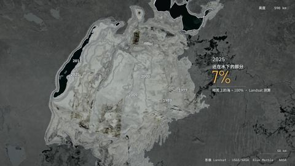</a><br>**Satellite Briefing**<br><sub>A satellite follows the map to the Aral Sea and finds a desert; the only part that came back is the part someone dammed.</sub> | <a href="styles/briefing-board/STYLE.md">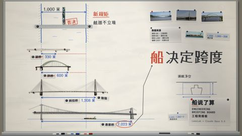</a><br>**Engineering Briefing Board**<br><sub>A river needs a bridge; four bridge types are tested on one briefing wall, and the ship that must pass underneath picks the winner.</sub> | <a href="styles/lidar-survey/STYLE.md">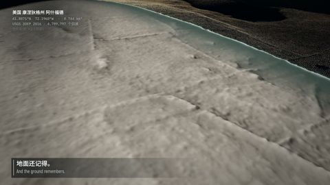</a><br>**LiDAR Survey**<br><sub>A laser survey strips the canopy off a Connecticut forest, layer by layer, and finds the stone walls of the farms that were there: 3.4 km of them, measured.</sub> |
| <a href="styles/white-model/STYLE.md">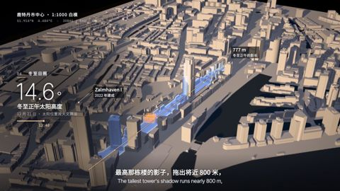</a><br>**Projection on White Model**<br><sub>A projector lights Rotterdam's white model layer by layer: what stood before 1940, the decades that filled the hole, the towers, and the winter shadow the tallest one casts on the pre-war roofs.</sub> | <a href="styles/data-physical/STYLE.md">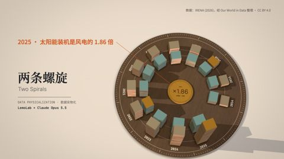</a><br>**Data Physicalization**<br><sub>Twelve years of wind and solar capacity stacked as real plates on a walnut dial: wind led in 2014, solar passed it in 2021, and by 2025 the ratio has turned the other way round.</sub> | <a href="styles/teardown/STYLE.md">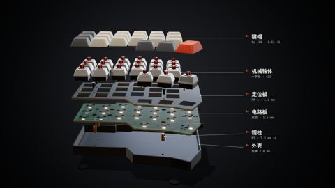</a><br>**Exploded Teardown**<br><sub>One half of an open-source keyboard comes apart in a single orbit, dives under its circuit board to the chip, the lights and the sockets, then closes with its real dimensions drawn on it.</sub> |
| <a href="styles/microscope/STYLE.md">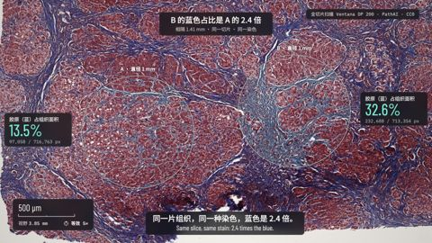</a><br>**Microscope Story**<br><sub>One continuous camera takes a liver slide from the eye down to a single nucleus; two circles 1.4 mm apart are counted pixel by pixel, and one holds 2.4 times the blue.</sub> | <a href="styles/archive-lighttable/STYLE.md">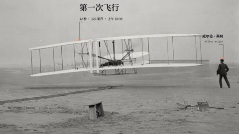</a><br>**Archive Light Table**<br><sub>The telegram said the longest flight lasted 57 seconds and the newspaper printed it; under a loupe, the Wright brothers' glass negatives and the Library of Congress record say 59.</sub> |   |

### Hand-drawn & Painting

|   |   |   |
|---|---|---|
| <a href="styles/crayon-book/STYLE.md">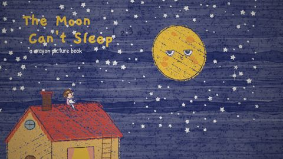</a><br>**Crayon Picture Book**<br><sub>The moon can't sleep, so a little girl climbs onto the roof to sing it a lullaby.</sub> | <a href="styles/watercolor/STYLE.md">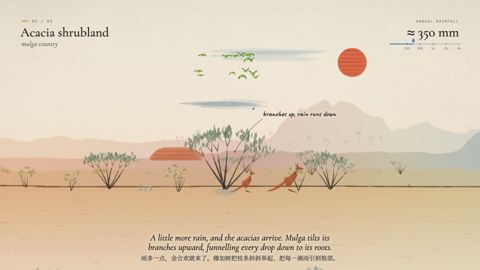</a><br>**Watercolor Brush**<br><sub>Follow the rain from Australia's red desert heart to its green coast in one unbroken painted walk.</sub> | <a href="styles/ink-wash/STYLE.md">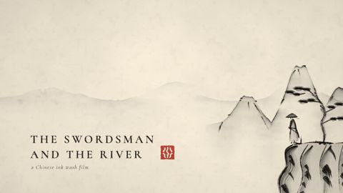</a><br>**Chinese Ink Wash**<br><sub>A swordsman crosses the river on the water and splits the current with a single stroke.</sub> |
| <a href="styles/impasto/STYLE.md">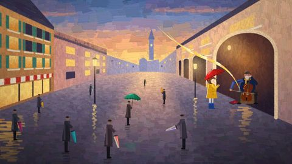</a><br>**Impasto Oil Painting**<br><sub>In a grey, rainy square one red umbrella opens, and a waltz paints the whole plaza in colour.</sub> | <a href="styles/one-line/STYLE.md">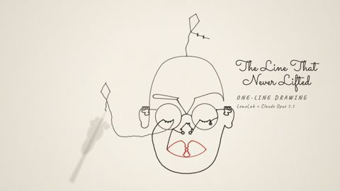</a><br>**One-line Drawing**<br><sub>One unbroken line draws a whole life, then the pen passes to a child.</sub> | <a href="styles/whiteboard/STYLE.md">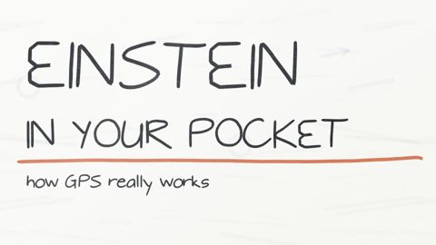</a><br>**Whiteboard Explainer**<br><sub>How your phone knows where you are: GPS, atomic clocks, and the 38 microseconds relativity adds every day.</sub> |
| <a href="styles/urban-sketch/STYLE.md">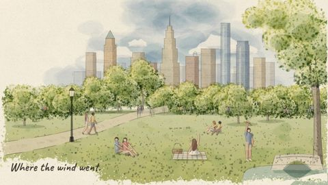</a><br>**Urban Sketch · Pen & Wash**<br><sub>A park that is only a pen sketch; wherever the wind carries her straw hat, colour follows.</sub> |   |   |

### East Asian Traditions

|   |   |   |
|---|---|---|
| <a href="styles/shadow-puppet/STYLE.md">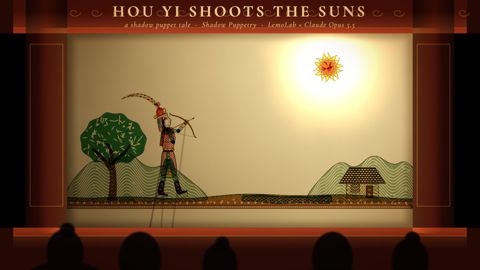</a><br>**Shadow Puppetry**<br><sub>Ten suns scorch the earth until the archer Hou Yi draws his bow, told with leather puppets on a lit screen.</sub> | <a href="styles/ukiyoe/STYLE.md">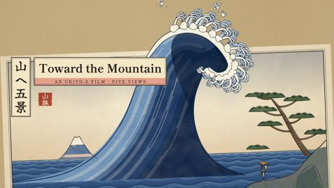</a><br>**Ukiyo-e**<br><sub>A traveller walks toward a distant mountain; every shot is a woodblock print, ending in a great wave.</sub> | <a href="styles/papercut-red/STYLE.md">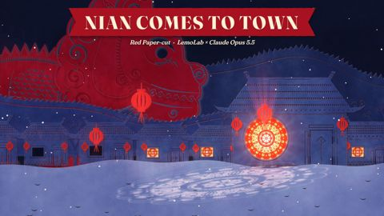</a><br>**Red Paper-cut**<br><sub>On New Year's Eve the beast Nian comes to town, and one girl's giant paper-cut lights up the village to scare it off.</sub> |
| <a href="styles/paper-lantern/STYLE.md">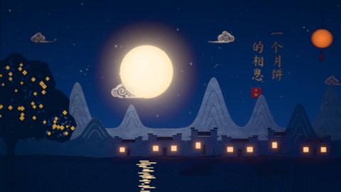</a><br>**Paper-cut Lightbox**<br><sub>A single mooncake tells the Mid-Autumn story of reunion and longing inside a glowing paper-cut lightbox.</sub> |   |   |

### Print & Printmaking

|   |   |   |
|---|---|---|
| <a href="styles/risograph/STYLE.md">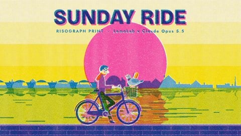</a><br>**Risograph Print**<br><sub>A Sunday-morning bike ride through the city — bakery, park, riverside — in two misregistered inks.</sub> | <a href="styles/halftone-dossier/STYLE.md">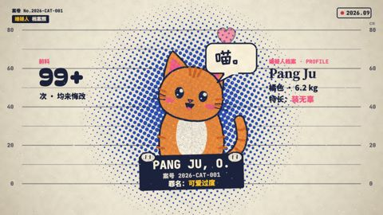</a><br>**Halftone Dossier**<br><sub>A chubby orange cat stands trial for testing gravity and 4 a.m. parkour, and walks free.</sub> | <a href="styles/woodcut/STYLE.md">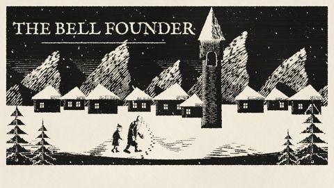</a><br>**Woodcut Print**<br><sub>A village spends a whole winter casting one bell; the first time it rings, the snow stops.</sub> |
| <a href="styles/engraving/STYLE.md">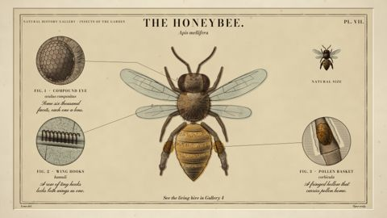</a><br>**Copperplate Engraving**<br><sub>A natural-history plate engraves itself: the burin cuts the copper, the bee builds up line by line, and a watercolour wash brings it to life.</sub> | <a href="styles/silkscreen-poster/STYLE.md">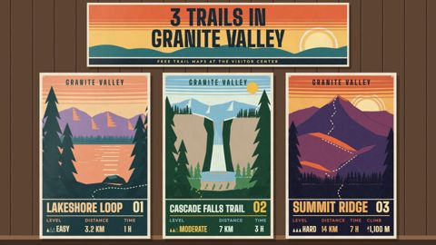</a><br>**Silkscreen Travel Poster**<br><sub>Three trail posters are screen-printed one ink at a time, then climbed in one long take from noon to dusk.</sub> |   |

### Graphic & Type

|   |   |   |
|---|---|---|
| <a href="styles/swiss-motion/STYLE.md">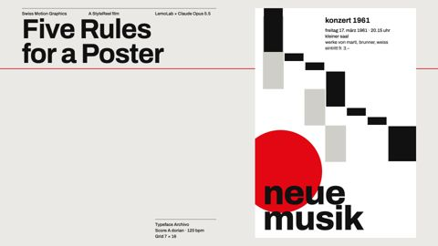</a><br>**Swiss Motion Graphics**<br><sub>A concert poster lays itself out by five Swiss design rules; the fifth is to break just one.</sub> | <a href="styles/spy-titles/STYLE.md">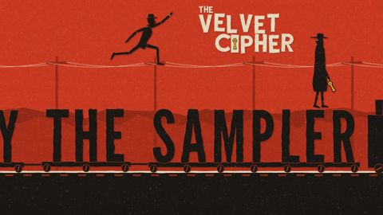</a><br>**60s Spy Title Sequence**<br><sub>Opening titles for an imaginary 1964 spy film: a chase for a stolen key until the shapes lock into the title.</sub> | <a href="styles/art-deco/STYLE.md">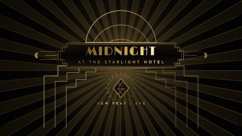</a><br>**Art Deco**<br><sub>A grand hotel, 1930: a bellboy races lifts and revolving doors to deliver one letter before midnight.</sub> |
| <a href="styles/blueprint/STYLE.md">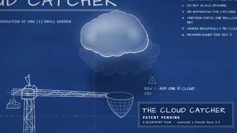</a><br>**Blueprint**<br><sub>An inventor's blueprint draws, explodes and assembles a cloud-catching machine, and its revision cloud starts to rain.</sub> | <a href="styles/stained-glass/STYLE.md">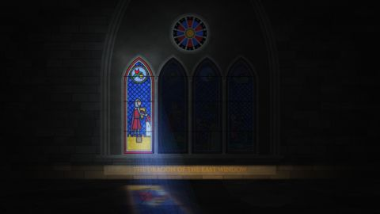</a><br>**Stained Glass**<br><sub>Sunlight crosses a cathedral window from dawn to dusk, waking each pane of a knight-and-dragon tale.</sub> | <a href="styles/pictogram-motion/STYLE.md">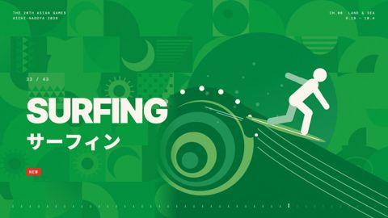</a><br>**Pictogram Motion**<br><sub>All 43 sports of the 2026 Asian Games as beat-locked geometric pictograms.</sub> |
| <a href="styles/ascii-crt/STYLE.md">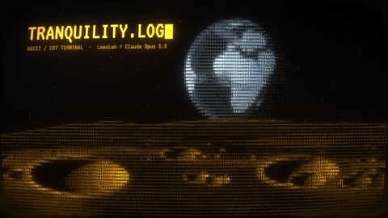</a><br>**ASCII / CRT Terminal**<br><sub>A moon-base AI wakes after forty years to a signal from Earth, and replies by drawing “home” in characters.</sub> |   |   |

### Information & Keynote

|   |   |   |
|---|---|---|
| <a href="styles/dataviz/STYLE.md">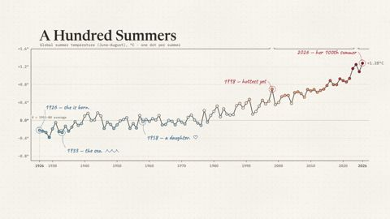</a><br>**Data Storytelling**<br><sub>A hundred years of summer temperatures, where the chart itself tells the story.</sub> | <a href="styles/iso-infographic/STYLE.md">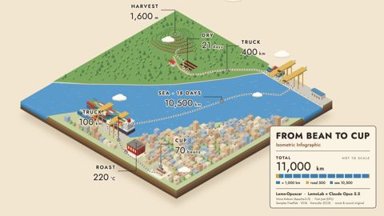</a><br>**Isometric Infographic**<br><sub>A coffee's journey from the plantation to your hands, across one isometric world.</sub> | <a href="styles/dark-keynote/STYLE.md">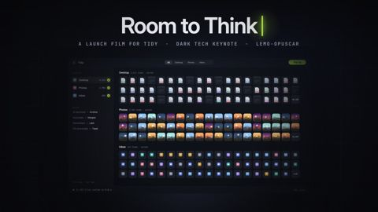</a><br>**Dark Tech Keynote**<br><sub>Launch film for Tidy, a fictional app: one buried cursor snaps hundreds of windows back into place.</sub> |
| <a href="styles/living-screencast/STYLE.md">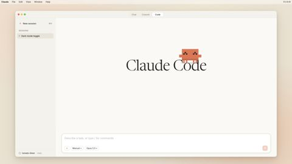</a><br>**Living Screencast**<br><sub>Clawd, the Claude Code pixel mascot, hops out of the terminal into the Claude app and acts out plan mode, diff comments and self-checks in a one-take screencast.</sub> | <a href="styles/hologram-hud/STYLE.md">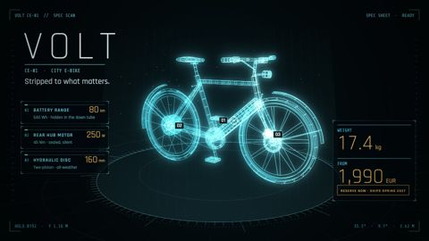</a><br>**Sci-fi Hologram HUD**<br><sub>An e-bike is scanned into a hologram; target boxes lock onto the battery, motor and brakes, and each spec rolls into place.</sub> |   |

### Cartoon & Anime

|   |   |   |
|---|---|---|
| <a href="styles/rubber-hose/STYLE.md">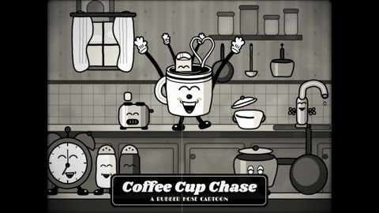</a><br>**1930s Rubber Hose Cartoon**<br><sub>A coffee cup chases a runaway sugar cube around the kitchen, 1930s-cartoon style.</sub> | <a href="styles/cel-anime-80s/STYLE.md">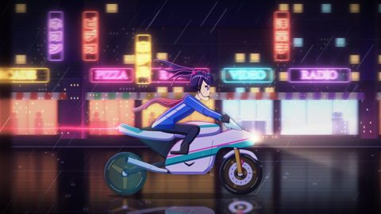</a><br>**80s Cel Anime**<br><sub>A courier girl rides through a rain-soaked neon city to deliver a tape before the dawn launch.</sub> | <a href="styles/scifi-toon/STYLE.md">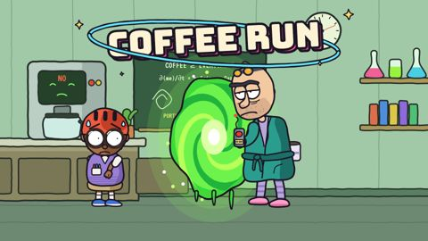</a><br>**Sci-Fi Sitcom Toon**<br><sub>A jaded genius opens a portal just to buy coffee and tumbles through ever-stranger universes.</sub> |
| <a href="styles/midcentury-toon/STYLE.md">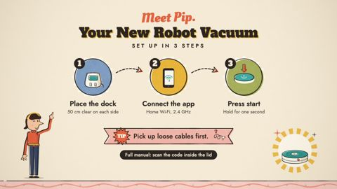</a><br>**Mid-century Cartoon**<br><sub>A robot vacuum set up in three steps, told like a 1950s classroom film: place the dock, connect the app, press start.</sub> | <a href="styles/kai-hand-draw/STYLE.md"></a><br>**Kai Hand-Draw Reel**<br><sub>Clawd stops a thumb before it hits POST and runs three quick checks, in a vertical watercolour reel with voice and word-locked captions.</sub> |   |

### Games

|   |   |   |
|---|---|---|
| <a href="styles/pixel-rpg/STYLE.md">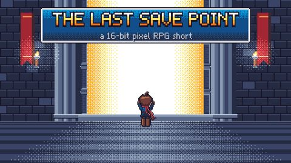</a><br>**16-bit Pixel RPG**<br><sub>At the final boss door a hero saves the game, and the save screen replays the whole journey.</sub> | <a href="styles/hd-2d/STYLE.md">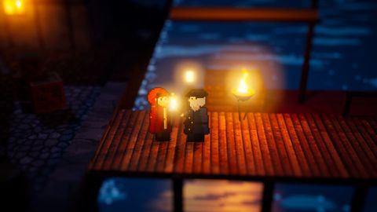</a><br>**HD-2D**<br><sub>The lighthouse goes dark; a girl carries the last flame through a night forest and up the storm cliffs.</sub> | <a href="styles/microgame/STYLE.md">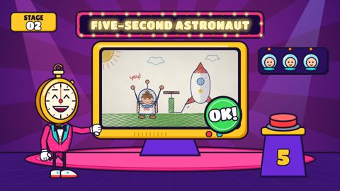</a><br>**Microgame Frenzy**<br><sub>A clumsy cadet survives a five-second boot camp, faster and faster, until the boss: landing home.</sub> |
| <a href="styles/game-show/STYLE.md">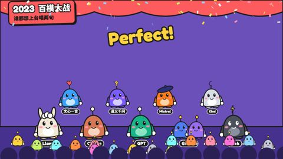</a><br>**Game Show Flat**<br><sub>The history of AI as a rhythm game: models take the stage on the beat, and a report card closes the show.</sub> |   |   |

### Cinema & Eras

|   |   |   |
|---|---|---|
| <a href="styles/silent-film/STYLE.md">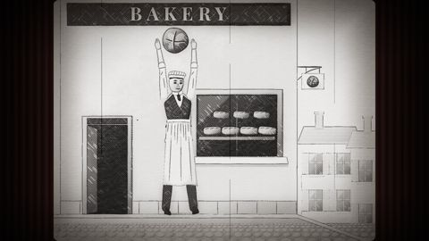</a><br>**1920s Silent Film**<br><sub>A baker's boy chases a runaway loaf downhill, then breaks it in half for a hungry girl.</sub> | <a href="styles/backrooms/STYLE.md">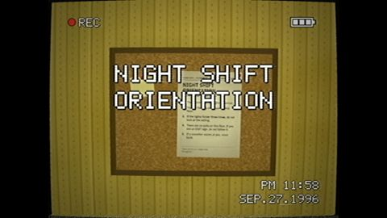</a><br>**Liminal Found Footage**<br><sub>A new night-shift hire films their first night in an endless yellow office, following the rules on the wall.</sub> |   |

### Materials & 3D

|   |   |   |
|---|---|---|
| <a href="styles/brick-toy/STYLE.md">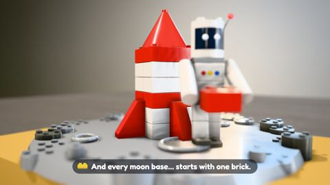</a><br>**Brick Toy**<br><sub>A brick astronaut builds a rocket from spare parts and flies to a brick moon.</sub> | <a href="styles/paper-popup/STYLE.md">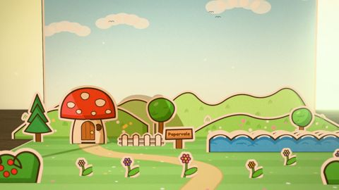</a><br>**Paper Pop-up Book**<br><sub>A pop-up book opens on a desk; a sprite named Pip adventures through paper worlds and jumps out into ours.</sub> | <a href="styles/tilt-shift/STYLE.md">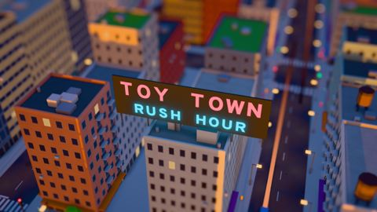</a><br>**Tilt-Shift Miniature**<br><sub>Morning rush hour in a town that looks like a model: traffic, trains and tiny people.</sub> |
| <a href="styles/lowpoly-island/STYLE.md">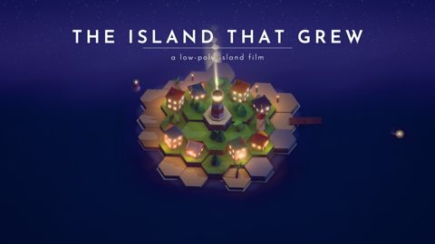</a><br>**Low-poly Isometric Island**<br><sub>An island and its village grow tile by tile from an empty sea, each tile a note, into a starry night.</sub> | <a href="styles/glass-product/STYLE.md"></a><br>**Glass Product Render**<br><sub>Unboxing and close-ups of Aura, fictional glass earbuds, in strip-light sweeps and caustics.</sub> |   |

<!-- GALLERY:END -->

Besides `kai-hand-draw`, the studio ships 51 more film styles (watercolor, ukiyo-e, pixel RPG, blueprint, data
storytelling and more), each with a `STYLE.md` and a demo film made in code. See
[`styles/README.md`](styles/README.md) for the full list, and ask Claude for a film in any of them about your own
topic. The guides the agent follows are [`AGENTS.md`](AGENTS.md), [`DIRECTOR.md`](DIRECTOR.md) and
[`TECHNIQUE.md`](TECHNIQUE.md); to change a style and keep it as your own, see [`MY-STYLES.md`](MY-STYLES.md).

## Credits and licence

Kaiships Studio's own code is MIT ([`LICENSE`](LICENSE)). It builds on open-source work, credited with its licences in
[`THIRD_PARTY_NOTICES.md`](THIRD_PARTY_NOTICES.md).
