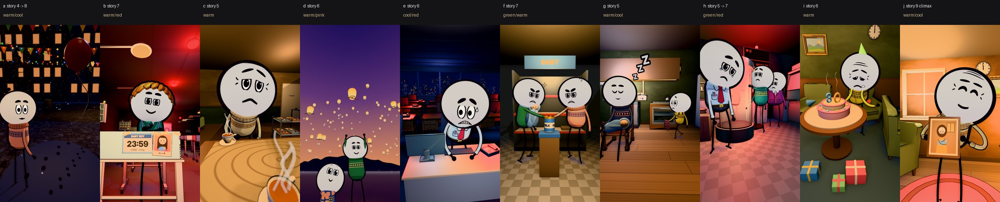

# Colour script (◇2c, made by agent:ep1-prepro, 26/11)

One frame per scene, in film order, with the intended story intensity (TREATMENT.md) and the hue families:

Numbers: colour-script.json (per-scene ranges measured on these stills, plus a margin). Events: a vanish at ONE, e phones go red, h flatline green to red.

| Scene | Story | Light | Risk measured |
| --- | --- | --- | --- |
| a countdown | 4 -> 8 | amber practicals, cool sky | median luma 10-18: darkest part of the film |
| b nursery | 7 | lamps, red pulse | rb up to 2.2 |
| c care home | 5 | low window sun | the warmest |
| d lantern | 6 | lantern amber, violet dusk | |
| e office | 6 | cold overhead, red phones | median luma under 30 |
| f shop | 7 | green-white strips, one warm lamp | |
| g kitchen | 5 | amber pendant, blue window | |
| h lab | 5 -> 7 | green heartbeat, red flatline | |
| i birthday | 6 | candle amber | |
| j last man | 9 climax | warm room, window warms | brightest, carries the climax |

The curve: the climax (j) is the brightest and warmest scene. Contrast does not rise with intensity in a and e (too dark); colourgate's film luma >= 100 and dark seconds <= 15 % will flag them at ◇5.
