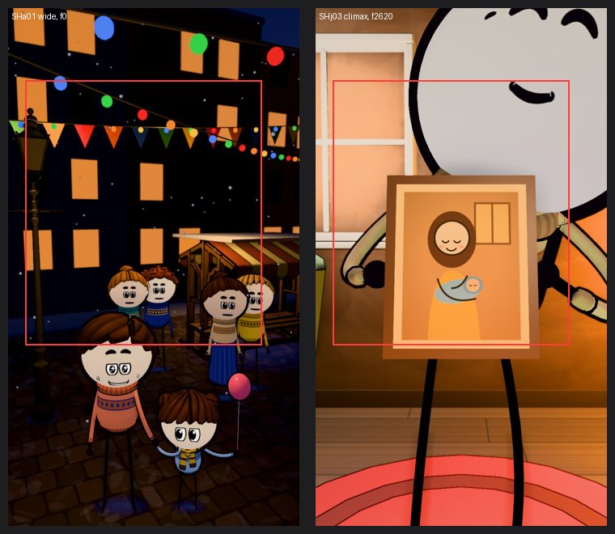

# Look (◇2c, made by agent:ep1-prepro, 26/11)

Look: LIGHT-RECIPE-V3 (colour in the lights, no grade), stills at final light from parts/
/renders.

Style frames on two locked shots, at phone size (360 px) with the text-safe box (x 6-87 %, y 14-65 %) in red:

| Shot | Still | Phone-size read |
| --- | --- | --- |
| SHa01 wide (f0) | parts/a/renders/beat_0.jpg | very dark: the square's median luma is under 30; the figure reads only on the lit floor pool |
| SHj03 climax (f2620) | parts/j/renders/beat_2620.jpg | the face, the smile and the photo read; the photo sits low, under the box |

Open: Kai has not signed the S1 series look (colour-script.json approved is empty).
